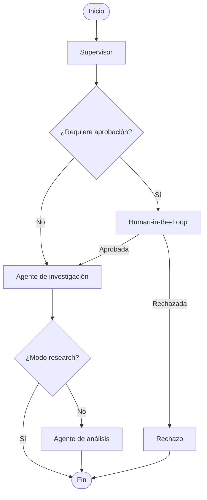

# The Intelligence System

Sistema de inteligencia artificial multiagente que combina Retrieval-Augmented Generation (RAG), LangGraph, Gemini y memoria persistente para responder consultas, investigar información y realizar análisis.

## Características

- **Arquitectura multiagente:** un supervisor coordina los agentes de investigación y análisis.
- **RAG híbrido:** recuperación de información desde Pinecone y una base de conocimiento local.
- **Embeddings:** generación de vectores mediante Gemini.
- **Memoria persistente:** LangGraph Checkpointer con SQLite y operaciones asíncronas.
- **Human-in-the-Loop (HITL):** las solicitudes consideradas críticas requieren aprobación humana antes de continuar.
- **API REST:** endpoints desarrollados con FastAPI.
- **Validación:** modelos Pydantic para solicitudes y respuestas.
- **Observabilidad:** trazabilidad de ejecuciones mediante LangSmith.
- **Pruebas:** suite automatizada con pytest.

## Tecnologías

| Tecnología | Uso |
|---|---|
| Python | Lenguaje principal |
| FastAPI | API REST |
| Pydantic | Validación de datos |
| LangGraph | Orquestación multiagente |
| LangChain Google GenAI | Integración con Gemini |
| Google Gemini | Generación de respuestas y embeddings |
| Pinecone | Almacenamiento y búsqueda vectorial |
| SQLite | Memoria persistente |
| LangSmith | Trazabilidad y observabilidad |
| Pytest | Pruebas automatizadas |

## Arquitectura del sistema

El supervisor determina el flujo de ejecución según el modo solicitado. Las solicitudes críticas pasan por un nodo de aprobación humana.



### Agentes

- **Supervisor:** selecciona el flujo de trabajo según el modo de ejecución y detecta solicitudes potencialmente críticas.
- **Research Agent:** consulta la información disponible mediante recuperación vectorial y búsqueda local.
- **Analyst Agent:** procesa la información y genera respuestas analíticas.
- **Approval Node:** pausa el flujo cuando se necesita autorización humana.
- **Rejected Node:** finaliza las solicitudes que no reciben aprobación.

### Modos de ejecución

| Modo | Comportamiento |
|---|---|
| `auto` | Investigación seguida de análisis |
| `research` | Recuperación e investigación de información |
| `analysis` | Ejecución directa del agente de análisis |

### RAG híbrido

El sistema combina dos fuentes de conocimiento:

1. **Pinecone:** búsqueda semántica sobre documentos almacenados en un índice vectorial.
2. **Base local:** búsqueda complementaria sobre `data/knowledge_base.json`.

Los embeddings se generan mediante el modelo configurado de Gemini.

### Memoria persistente

LangGraph utiliza `AsyncSqliteSaver` para guardar el estado de las conversaciones en SQLite. Cada conversación se identifica mediante un `thread_id`, que permite recuperar su estado entre solicitudes y reinicios de la aplicación.

### Human-in-the-Loop

Las solicitudes que coinciden con determinados criterios de criticidad pueden quedar pausadas hasta recibir una decisión humana.

- Si se aprueba, el grafo continúa.
- Si se rechaza, el flujo finaliza sin continuar con el procesamiento solicitado.

Este mecanismo implementa un flujo de aprobación; no ejecuta por sí mismo operaciones externas destructivas.

## Estructura del proyecto

```text
the-intelligence-system/
│
├── app/
│   ├── agents/
│   │   ├── analyst_agent.py
│   │   ├── hitl.py
│   │   ├── research_agent.py
│   │   └── supervisor.py
│   │
│   ├── memory/
│   │   └── checkpointer.py
│   │
│   ├── rag/
│   │   ├── embeddings.py
│   │   ├── local_retriever.py
│   │   └── retriever.py
│   │
│   ├── schemas/
│   │   ├── requests.py
│   │   └── responses.py
│   │
│   ├── services/
│   │   └── llm.py
│   │
│   ├── config.py
│   ├── graph.py
│   ├── main.py
│   ├── observability.py
│   └── state.py
│
├── data/
│   └── knowledge_base.json
│
├── scripts/
│   ├── check_embeddings.py
│   ├── check_pinecone.py
│   ├── ingest.py
│   └── run_traced_tests.py
│
├── tests/
│   ├── test_agents.py
│   ├── test_api.py
│   ├── test_memory.py
│   ├── test_rag.py
│   └── test_validation.py
│
├── .env.example
├── .gitignore
├── requirements.txt
├── run.ps1
└── README.md
```

## Requisitos previos

- Python 3.14 o compatible.
- Una API Key de Google AI Studio para Gemini.
- Una cuenta de Pinecone y un índice vectorial configurado.
- Una API Key de LangSmith para habilitar la trazabilidad.

## Instalación

Clonar el repositorio:

```bash
git clone https://github.com/Lorenzogomezmartins/CoderHouse-Trabajo-Final.git
cd CoderHouse-Trabajo-Final
```

Crear el entorno virtual:

```powershell
python -m venv .venv
```

Activarlo:

```powershell
.\.venv\Scripts\Activate.ps1
```

Instalar las dependencias:

```powershell
python -m pip install --upgrade pip
pip install -r requirements.txt
```

Configurar las variables de entorno:

```powershell
Copy-Item .env.example .env
```

Completar `.env` con las credenciales y los datos de los servicios utilizados.

## Variables de entorno

| Variable | Descripción |
|---|---|
| `APP_NAME` | Nombre de la aplicación |
| `APP_ENV` | Entorno de ejecución |
| `DEBUG` | Modo de depuración |
| `GOOGLE_API_KEY` | Clave de Google AI Studio |
| `GEMINI_MODEL` | Modelo de generación |
| `GEMINI_EMBEDDING_MODEL` | Modelo de embeddings |
| `EMBEDDING_DIMENSION` | Dimensión de los vectores |
| `PINECONE_API_KEY` | Clave de Pinecone |
| `PINECONE_INDEX_NAME` | Nombre del índice vectorial |
| `PINECONE_NAMESPACE` | Namespace de Pinecone |
| `DATABASE_PATH` | Ruta de la base SQLite |
| `LANGSMITH_TRACING` | Habilita la trazabilidad |
| `LANGSMITH_API_KEY` | Clave de LangSmith |
| `LANGSMITH_PROJECT` | Proyecto de trazabilidad |
| `LANGSMITH_ENDPOINT` | Endpoint de LangSmith |

No subir el archivo `.env` ni compartir sus credenciales.

## Ejecución

La aplicación puede iniciarse desde PowerShell con un solo comando:

```powershell
.\run.ps1
```

La API estará disponible en:

- API: http://127.0.0.1:8000
- Documentación Swagger: http://127.0.0.1:8000/docs
- OpenAPI: http://127.0.0.1:8000/openapi.json
- Health check: http://127.0.0.1:8000/health

También puede iniciarse directamente con:

```powershell
.\.venv\Scripts\python.exe -m uvicorn app.main:app --reload
```

## Endpoints

| Método | Endpoint | Descripción |
|---|---|---|
| `GET` | `/health` | Estado de la API |
| `POST` | `/query` | Ejecuta una consulta |
| `POST` | `/tasks` | Inicia el flujo de una tarea |
| `GET` | `/tasks/{thread_id}` | Consulta el estado de una tarea |
| `POST` | `/tasks/{thread_id}/approve` | Aprueba o rechaza una tarea pausada |

### Ejemplo: consulta

`POST /query`

```json
{
  "question": "¿Qué es una API REST?",
  "mode": "research"
}
```

También se puede enviar un `thread_id` para continuar una conversación existente.

### Ejemplo: aprobación humana

`POST /tasks/{thread_id}/approve`

```json
{
  "approved": true
}
```

Para rechazar la solicitud:

```json
{
  "approved": false
}
```

## Pruebas

Ejecutar toda la suite:

```powershell
.\.venv\Scripts\python.exe -m pytest tests -v
```

El proyecto cuenta con pruebas para:

- Agentes y flujo de ejecución.
- Endpoints de la API.
- Memoria persistente.
- Recuperación RAG.
- Validaciones de entrada.

Para ejecutar las cinco consultas de prueba con trazabilidad en LangSmith:

1. Iniciar la API con `.\run.ps1` o Uvicorn.
2. Abrir otra terminal en la carpeta del proyecto.
3. Ejecutar:

```powershell
.\.
