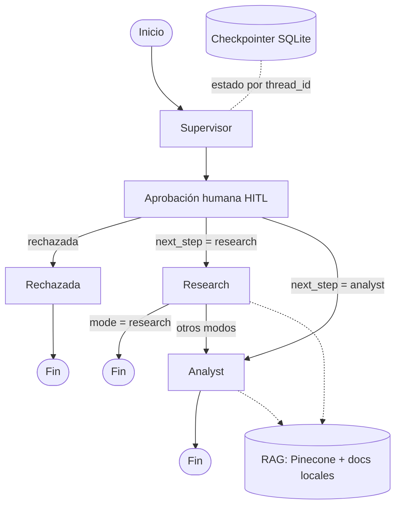

$readme = @'
# The Intelligence System

Sistema multiagente con RAG híbrido, revisión humana (HITL), memoria persistente y observabilidad. Resuelve consultas técnicas combinando conocimiento específico (RAG con Pinecone y documentos locales) con razonamiento multi-paso (agentes en LangGraph), expuesto mediante una API FastAPI documentada.

## Requisitos

- Python 3.12+
- Docker Desktop (para el despliegue con Docker Compose)
- Cuentas y claves de: Google AI (Gemini), Pinecone y LangSmith

## Arquitectura



- **Supervisor:** decide a qué agente delega cada pregunta.
- **Aprobación humana (HITL):** pausa las tareas que requieren confirmación (`/tasks`).
- **Research / Analyst:** consultan los RAG y generan la respuesta con Gemini.
- **Memoria persistente:** `AsyncSqliteSaver` guarda el estado por `thread_id`, así las conversaciones sobreviven a reinicios.
- **Validación:** esquemas Pydantic en entradas, salidas de agentes y documentos recuperados.
- **Asincronía:** toda la E/S (LLM, Pinecone, base de datos) usa `async/await`.

## Instalación local

```powershell
python -m venv .venv
.\.venv\Scripts\Activate.ps1
pip install -r requirements.txt
copy .env.example .env
```

Completá las claves en `.env` y ejecutá:

```powershell
uvicorn app.main:app --reload
```

La API queda en `http://localhost:8000` y la documentación en `http://localhost:8000/docs`.

## Variables de entorno

| Variable | Descripción |
|---|---|
| `APP_NAME`, `APP_ENV`, `DEBUG` | Configuración general |
| `GOOGLE_API_KEY` | Clave de Gemini |
| `GEMINI_MODEL` | Modelo de generación |
| `GEMINI_EMBEDDING_MODEL`, `EMBEDDING_DIMENSION` | Modelo y dimensión de embeddings |
| `PINECONE_API_KEY`, `PINECONE_INDEX_NAME`, `PINECONE_NAMESPACE` | Configuración de Pinecone |
| `DATABASE_PATH` | Ruta de la base SQLite del checkpointer |
| `LANGSMITH_TRACING`, `LANGSMITH_API_KEY`, `LANGSMITH_PROJECT`, `LANGSMITH_ENDPOINT` | Observabilidad con LangSmith |

El archivo `.env` real nunca se sube a Git (está en `.gitignore`).

## Despliegue con Docker Compose

Con una sola instrucción:

```powershell
docker compose up -d --build
```

Verificación:

```powershell
docker compose ps
Invoke-RestMethod http://localhost:8000/health
```

La carpeta `./data` se monta como volumen, por lo que la base de memoria persiste aunque el contenedor se reinicie o se recree. Para detener: `docker compose down`.

## Observabilidad con LangSmith

1. Creá una cuenta y una API key en https://smith.langchain.com.
2. En `.env` configurá `LANGSMITH_TRACING=true`, `LANGSMITH_API_KEY` y `LANGSMITH_PROJECT=the-intelligence-system`.
3. Ejecutá consultas (por ejemplo desde `/docs`) o el script de pruebas:

```powershell
.\.venv\Scripts\python.exe scripts\run_traced_tests.py
```

4. Abrí el proyecto `the-intelligence-system` en LangSmith: cada ejecución del grafo aparece como una traza `langgraph_execution` con sus pasos, tiempos y tokens.

## Endpoints

| Método | Ruta | Descripción |
|---|---|---|
| GET | `/health` | Estado de la aplicación |
| POST | `/query` | Consulta directa. Acepta `question`, `thread_id` (opcional) y `mode` |
| POST | `/tasks` | Crea una tarea que puede requerir aprobación humana |
| GET | `/tasks/{thread_id}` | Estado de una tarea |
| POST | `/tasks/{thread_id}/approve` | Aprueba o rechaza una tarea pendiente |

Ejemplo de memoria entre consultas:

```json
{"question": "Mi lenguaje favorito es Python"}
```

Luego, con el `thread_id` devuelto:

```json
{"question": "¿Cuál es mi lenguaje favorito?", "thread_id": "ID_DEVUELTO"}
```

## Tests

```powershell
.\.venv\Scripts\python.exe -m pytest -q
```

## Estructura del proyecto